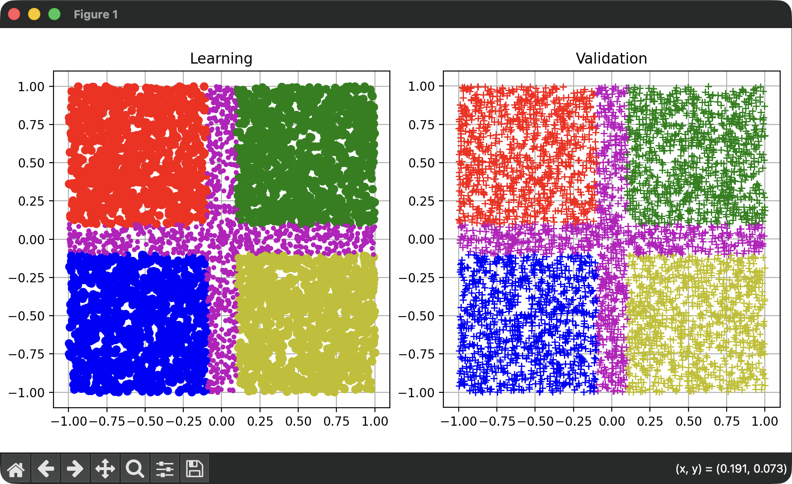

# Classification with the TensorFlow Lite Library

(c) 2025-2026, Edo. Franzi, 2026-07-29

## Introduction

This is an example of a complete neural network classifier demonstrating the full capabilities of µKOS-X in conjunction with TensorFlow Lite. The goal is to present, step by step, how to design and implement such a classifier.

As an illustrative case, we build a model capable of classifying 2D coordinates (x, y), where both values range from -1 to 1, into five distinct classes:

- **Class A (red):** top-left cluster
- **Class B (green):** top-right cluster
- **Class C (blue):** bottom-left cluster
- **Class D (yellow):** bottom-right cluster
- **Inter-class (violet):** the regions between all clusters

This example demonstrates how a neural network using µKOS-X can learn and distinguish different geometric regions in a two-dimensional space.



## Dataset Creation and Classifier Generation

The trained model is not kept in git: after a clone, `_Training/NN_model.xxd` does not exist until the command below has been run. Compiling the application without it stops with an error; train the network, then compile again.

### Dataset creation

The learning dataset `DB_L_file.txt` and the validation dataset `DB_V_file.txt` are created by `DB_Creator.py`. `build.sh` runs it when the two files do not exist yet and reuses them otherwise. To create them yourself, for instance with another seed:

```bash
# Create the learning DB_L_file.txt and the validation DB_V_file.txt files
cd _Training
python3 DB_Creator.py [-seed nnn]
```

The random generator is seeded with `nnn`, or with 42 when `-seed` is omitted, so the same seed always produces the same datasets. The script overwrites both files and plots the two datasets; close the plot window to finish. Run `build.sh` afterwards to train the network on the new datasets.

### Create the Neural Network

The file `NN_model.py` contains the description of the neural network architecture and its training parameters.

The script reads the learning dataset `DB_L_file.txt` (20 % of it is held out for validation), trains the network with TensorFlow/Keras, and converts the trained network to a TensorFlow Lite model (`NN_model.tflite`). It then runs the TFLite model on a few reference points so that its outputs can be compared with those of the Keras model. The Keras model is also saved, as `NN_model.keras`.

The script `build.sh` runs this step. It activates the µKOS-X TensorFlow Lite Python environment when present, sends the TensorFlow warnings to `NN_model_warnings.log`, and converts `NN_model.tflite` into the hexadecimal dump `NN_model.xxd`, which is the form of the model kept with the application.

```bash
# Train the network and create NN_model.xxd
cd _Training
./build.sh
```

### Embed the model in the application

The application includes the file `_Training/NN_model.c_inc`, which contains the complete TFLite model (network structure and trained weights) as the C array `NN_model_tflite[]` and its length `NN_model_tflite_len`. The classifier therefore needs no external model file at runtime.

There is nothing to do by hand: the CMake build of the application regenerates `NN_model.c_inc` from `NN_model.xxd`. After a new training, simply rebuild the application.
